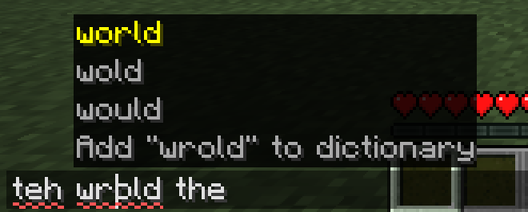
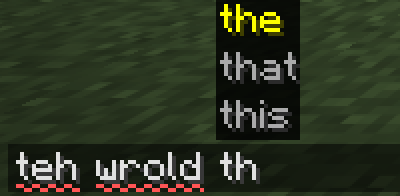

**Better Typing**

spell check, autocomplete and ctrl+z for minecraft



a client-side fabric mod for **1.21.11, 26.1, 26.2 and 26.3**. it works in chat, anvil renaming, signs and books, and draws its suggestions the way vanilla draws command suggestions

**spell check**

misspelled words get a red squiggle. the word you're still typing isn't underlined until you move past it

put the cursor on one and press **tab**: 3 suggestions show up above it, plus "add to dictionary"

**autocomplete**



after 2 letters, up to 3 words for the one you're typing show up above the field. accepting one adds a space after it, like a phone keyboard

**picking a suggestion**

- **tab** highlights the first one, every next tab moves down and wraps around
- **space** takes the highlighted one. with nothing highlighted it's just a space
- **escape** closes the list first, like vanilla's command list. a second escape closes the screen

lines starting with `/` are left alone, so tab still completes commands and player names

**undo and redo**

**ctrl+z** undoes, **ctrl+shift+z** and **ctrl+y** redo, in every text field. typing is undone a word at a time, an accepted suggestion is its own step. every sign line and book page keeps its own history. on macos ctrl is cmd, like vanilla's copy and paste

**words**

english, with american spelling. item and mob names count as correct in the game's language, modded ones too. player names don't

words you add go to `config/bettertyping/personal_dictionary.txt`. the shortcuts and the on/off switches are in `config/bettertyping/settings.properties`, e.g. `key.undo=ctrl+z`

**not there yet**

- [ ] a settings screen, with a mod menu button and a `/bettertyping` command
- [ ] rebinding the shortcuts from the game
- [ ] more languages and british spelling as downloads
- [ ] better autocomplete order. words are ranked by how often they show up in books, so `hel` gives held, help and helped before hello
- [ ] on signs and in books the list can cover the line above

**[building](./versions)**

gradle runs on java 25, the 1.21.11 jar targets java 21

```sh
./gradlew build                     # every version, jars in versions/<mc>/build/libs/
./gradlew :26.3:runClient           # a dev client, its worlds stay in run/26.3
./gradlew :core:test                # unit tests
./gradlew :26.3:runClientGameTest   # opens the game and types through chat, a sign and a book
```

the in-game test checks the text after every step (20 checks) and saves screenshots to `run/<mc>/screenshots/`. the images above come from there

<details>
<summary>how it's laid out</summary>

<br>

| folder | what's in it |
|---|---|
| `core/` | plain java, no minecraft. `TypingSession` is the way in: one per screen, it takes keys and characters and says what to draw. behind it are the spell checker, autocomplete and undo history |
| `common/` | minecraft code every version shares: screen hooks, drawing, item and mob names. `field/` adapts each kind of text field (text box, sign line, book page) |
| `common/src/gametest/` | the in-game test |
| `variants/` | code for groups of versions that share an api: how screens draw, which key codes there are, small 26.2 changes |
| `versions/<mc>/` | one gradle project per version. its `gradle.properties` picks minecraft, fabric api, mod menu and which variants to use |

the words used in the code are in [CONTEXT.md](CONTEXT.md)

</details>

**[the word list](./tools/build_dictionary.py)**

109,902 english words in `common/src/main/resources/assets/bettertyping/dictionaries/en_us.txt`, one per line, most common first

- which words are correct: the [english speller database](https://github.com/en-wl/wordlist) (scowl), release `rel-2026.02.25`, size 60, american. the same source as the libreoffice and hunspell english dictionaries
- the order: google books counts from [gwordlist](https://github.com/hackerb9/gwordlist). words without a count go last

<details>
<summary>rebuilding it</summary>

<br>

```sh
git clone --depth 1 --branch rel-2026.02.25 https://github.com/en-wl/wordlist.git esdb
(cd esdb && make && for s in 35 40 50 60; do ./scowl word-list $s A 1 --deaccent > ../wl-$s.txt; done)
curl -LO https://raw.githubusercontent.com/hackerb9/gwordlist/master/frequency-alpha-alldicts.txt
python3 tools/build_dictionary.py --esdb-lists wl-35.txt wl-40.txt wl-50.txt wl-60.txt \
  --frequency frequency-alpha-alldicts.txt --max-size 60 \
  --out common/src/main/resources/assets/bettertyping/dictionaries/en_us.txt
```

stay at size 70 or below. past 80 the list pulls in the uk advanced cryptics dictionary, which needs its own notice, and the australian data needs one too

</details>

<details>
<summary>word list notices</summary>

<br>

Copyright 2000-2026 by Kevin Atkinson. Permission to use, copy, modify, distribute, and sell any part of SCOWLv2, or word lists created from it, is hereby granted without fee, provided that the above copyright notice appears in all copies and that both the above copyright notice and this notice appear in supporting documentation. Kevin Atkinson makes no representations about the suitability of this database for any purpose. It is provided "as is" without express or implied warranty.

gwordlist by hackerb9 is compiled from the Google Books Ngram dataset by Google, licensed under [CC BY 3.0](https://creativecommons.org/licenses/by/3.0/). it's only used to sort the words.

both ship in every jar as [THIRD_PARTY_NOTICES.txt](common/src/main/resources/THIRD_PARTY_NOTICES.txt). keep that file, and these notices on the download page

</details>

_credits: [english speller database](https://github.com/en-wl/wordlist) by kevin atkinson, [gwordlist](https://github.com/hackerb9/gwordlist) by hackerb9_
